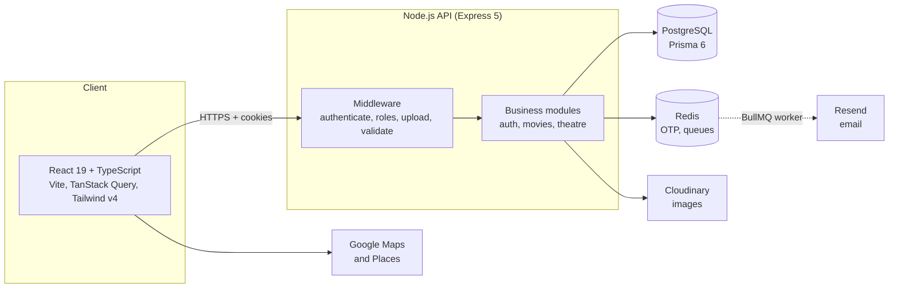
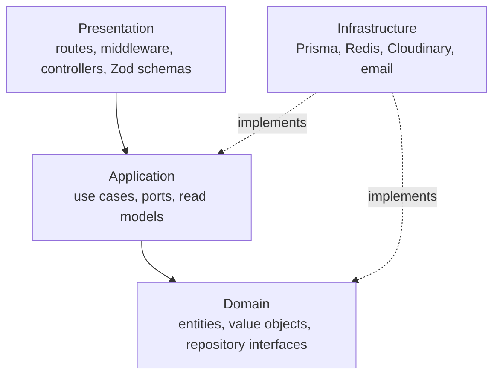
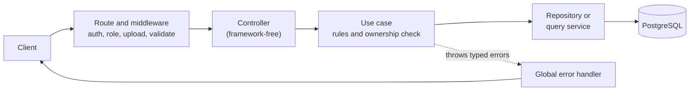
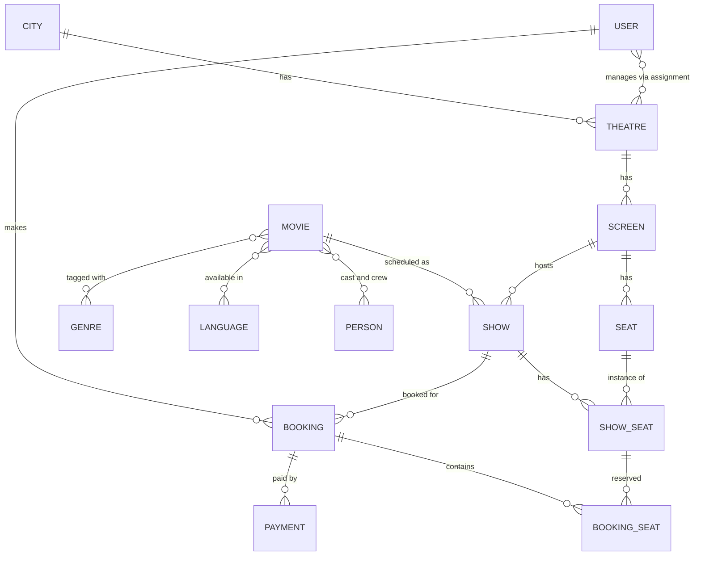
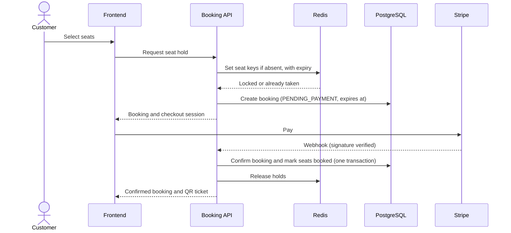

<div align="center">


<a href="https://git.io/typing-svg"></a>

<br/>

<p>
  A BookMyShow-inspired movie ticket booking platform built with <b>React</b>, <b>Node.js</b>, <b>TypeScript</b>, <b>PostgreSQL</b> and <b>Redis</b>.<br/>
  Super admins manage movies and theatres, theatre admins design their screens and seat layouts, and customers will book seats and pay online.
</p>

<p>
  
  
  
  
</p>

<p>
  
  
  
  
</p>

<p>
  <a href="#overview">Overview</a> &nbsp;|&nbsp;
  <a href="#project-status">Status</a> &nbsp;|&nbsp;
  <a href="#features">Features</a> &nbsp;|&nbsp;
  <a href="#tech-stack">Tech stack</a> &nbsp;|&nbsp;
  <a href="#architecture">Architecture</a> &nbsp;|&nbsp;
  <a href="#getting-started">Getting started</a> &nbsp;|&nbsp;
  <a href="#roadmap">Roadmap</a>
</p>

</div>

<!--
  DEMO MEDIA (add your own, then remove this comment markers):
  Record a short GIF of the seat layout editor and the theatre management flow, save them in docs/media/, then use:

  <div align="center">
    
  </div>
-->

---

## Table of contents

- [Overview](#overview)
- [Project status](#project-status)
- [Features](#features)
- [Tech stack](#tech-stack)
- [Architecture](#architecture)
- [Data model](#data-model)
- [Seat layout design](#seat-layout-design)
- [Planned booking flow](#planned-booking-flow)
- [API overview](#api-overview)
- [Project structure](#project-structure)
- [Getting started](#getting-started)
- [Testing](#testing)
- [Security](#security)
- [Engineering decisions](#engineering-decisions)
- [Roadmap](#roadmap)
- [Contributing](#contributing)
- [Author](#author)
- [License](#license)

---

## Overview

Moviera models how a real cinema booking platform works, from the cinema owner's setup to the customer's checkout:

1. A **Super Admin** adds movies, registers theatres and assigns theatre administrators.
2. A **Theatre Admin** manages the theatres assigned to them: creates screens, generates a seat grid in bulk, and drags seats into the real shape of the hall.
3. A **customer** (in progress) will browse movies, pick seats on a live seat map, pay with Stripe and receive a QR ticket.

The project is as much about **engineering quality** as about features: a modular-monolith backend with Clean Architecture, read and write separation, ownership-based authorization, atomic database operations, and one consistent error contract from the API to the form fields.

> **Status note.** Moviera is under active development. The sections below mark every feature as built, in progress or planned, so you always know what is running today.

---

## Project status

| Area | Status | Notes |
|---|---|---|
| Authentication (OTP, Google, JWT cookies, refresh) | ✅ Built | Redis-backed OTP with expiry and resend, BullMQ email jobs, role-based access |
| Movie management (admin) | ✅ Built | Create, update, activate and deactivate, image uploads, cast and crew, filters, search, pagination |
| Theatre management | ✅ Built | Create with Google Maps picker, list, details page, facilities, admin assignment |
| Screens and seat management (API) | ✅ Built | Screens, bulk seat generation, atomic layout updates, seat updates |
| Seat layout editor (UI) | 🚧 In progress | Interactive canvas with drag, rotate, zoom and save |
| Unified error handling and validation | 🚧 In progress | Zod and React Hook Form on the client, one error envelope on the API |
| Design system and responsive UI | 🚧 In progress | Tailwind v4 tokens, BookMyShow-inspired look |
| Public movie browsing | 📅 Planned | Active movies only, by slug |
| Shows (scheduling) | 📅 Planned | Show creation, timing validation, show seats |
| Booking, seat locking and payments | 📅 Planned | Redis locks, Stripe checkout and webhooks, QR tickets |

---

## Features

### Super Admin

- Create and update movies with poster and backdrop uploads, genres, languages, cinema formats, cast and crew.
- Activate and deactivate movies. Search, filter (genre, language, certification, status, release date), sort and paginate the movie list.
- Create theatres with a logo, contact details, licence number and an address picked on an interactive **Google Maps** map (draggable marker, reverse geocoding, Places autocomplete, "use my location").
- Manage theatre facilities and assign theatre administrators to theatres.
- Browse theatres with debounced search, status filter and server-side pagination, and open a detailed theatre page with tabs.

### Theatre Admin

- Manage only the theatres assigned to them (enforced by an ownership check, not just a role check).
- Create screens and see a summary per screen: total seats, rows, shows and configuration status.
- Generate a seat grid in bulk by describing rows (label, seat count, type): up to 50 seats per row and 1,000 seats per screen.
- Read and update the seat layout (positions and rotation) with an **atomic batch update**, and change seat type or active status.
- Visual seat layout editor on a canvas *(in progress)*.

### Customer *(planned)*

- Browse movies that are now showing, choose a show and pick seats on a live seat map.
- Hold seats temporarily, pay with Stripe and receive a booking confirmation with a QR ticket.
- View booking history and ticket details.

---

## Tech stack

<div align="center">


</div>

| Layer | Technologies |
|---|---|
| **Frontend** | React 19, TypeScript, Vite, React Router 7, TanStack Query 5, Zustand 5, React Hook Form, Zod, Tailwind CSS v4, Axios, Lucide icons |
| **Backend** | Node.js, TypeScript, Express 5, Prisma 6, Zod, JWT, BullMQ |
| **Data** | PostgreSQL, Redis |
| **Services** | Cloudinary (images), Resend (email), Google Maps and Places, Google OAuth, Cloudflare Turnstile, Sentry |
| **Payments** *(planned)* | Stripe (checkout and webhooks) |
| **Quality** | Vitest, Supertest, Testing Library, ESLint |
| **DevOps** | Docker |

<p>
  
  
  
  
  
  
</p>

---

## Architecture

### System overview



### Modular monolith with Clean Architecture

The backend is one deployable application split into business modules (`auth`, `movies`, `theatre`; `show`, `booking` and `payment` are planned). Every module has the same four layers, and dependencies only point inward:



| Idea | How it is applied |
|---|---|
| **Dependency rule** | The domain imports nothing from Express, Prisma or Zod. Infrastructure implements interfaces that the inner layers declare |
| **CQRS-lite** | Commands go through repositories and aggregates. Queries go through query services that use Prisma `select` and return read models, so list pages never load heavy relations |
| **Ports and adapters** | Use cases depend on interfaces (storage, query services, access policy). Concrete classes are wired once per module |
| **Composition root** | Each module has a build function that receives shared infrastructure (Prisma client, storage) and returns its routers. Plain constructor injection, no container library |
| **Framework-free controllers** | Controllers take a plain request object and return a plain response object. A small adapter connects them to Express |
| **Module boundaries** | A module exposes a small public API (`index.ts`) and keeps everything else private |

### Request lifecycle



Middleware order on protected routes is **authenticate, authorize role, upload, validate**, so unauthenticated users can never upload files or trigger validation work.

---

## Data model

The Prisma schema already models the full booking domain. Movies, theatres, screens and seats are implemented; shows, bookings and payments are modelled and will be implemented next.



<details>
<summary><b>Notable schema decisions</b></summary>

<br/>

- **Composite unique keys** on every join table and on names and slugs per scope (for example a theatre slug is unique per city, a screen slug per theatre, a seat label per screen).
- **Money is stored as integers in paise**, never as floating point numbers.
- **Booking snapshots**: movie title, theatre, screen, show time, seat labels and prices are copied into the booking, so history never changes when a record is edited later.
- **Idempotency**: a unique idempotency key on payments and a unique booking reference make retries and webhook replays safe.
- **Soft delete** on theatres, so data can be restored instead of lost.
- **Normalized seat coordinates** (0 to 1) plus rotation, so a layout does not depend on screen size.

</details>

---

## Seat layout design

Seat positions are stored as fractions between `0` and `1`, so the same layout renders correctly on any device. When a screen's seats are generated, each seat gets a starting position from its row and index:

```text
x = (seatIndex + 1) / (seatsInRow + 1)
y = (rowIndex  + 1) / (totalRows  + 1)
```

The admin then drags seats into place. Key rules:

- **One atomic batch update.** Up to 1,000 seats move in a single request, inside a database transaction guarded by a PostgreSQL **advisory lock** per screen. Concurrent edits to the same screen run one after another, and the whole update is rolled back if any seat is missing.
- **Bulk generation only for an empty screen**, with limits of 50 seats per row and 1,000 per screen.
- **Seat types:** Regular, Premium, Recliner, Wheelchair, Sofa.
- **Editor design** *(in progress)*: a draft and a baseline copy of the layout, dirty-state tracking, a two-step save (positions in one batch, properties per seat), and a canvas built for about a thousand seats.

---

## Planned booking flow

> This is the design for the upcoming booking module, not a description of running code.



**Preventing double booking uses two layers:** a fast Redis hold per seat with an expiry, and a final conditional database update that only books seats that are still available and checks the updated row count. Redis is the fast layer, and the database is the source of truth. Webhooks are handled idempotently, and a background job expires unpaid bookings.

---

## API overview

All errors share one envelope, so clients can rely on a stable `code`:

```json
{
  "success": false,
  "code": "CONFLICT",
  "message": "A screen with this name already exists",
  "details": { "field": "name" }
}
```

<details>
<summary><b>Selected endpoints (current)</b></summary>

<br/>

Paths are relative to the API base URL and may change as the public API is added.

| Area | Method and path | Purpose | Access |
|---|---|---|---|
| Movies | `GET /movies/admin` | Paginated admin list with search, filters and sorting | Super Admin |
| Movies | `GET /movies/admin/:slug` | Movie detail for the admin | Super Admin |
| Movies | `POST /movies` | Create a movie (multipart: poster, backdrop) | Super Admin |
| Movies | `PATCH /movies/:id` | Update a movie | Super Admin |
| Screens | `POST /theatres/screens` | Create a screen | Assigned admin or Super Admin |
| Screens | `GET /theatres/:theatreId/screens` | List screens with seat summary | Assigned admin or Super Admin |
| Seats | `POST /theatres/screens/:screenId/seats/bulk` | Generate seats for an empty screen | Assigned admin or Super Admin |
| Seats | `GET /theatres/screens/:screenId/seat-layout` | Read the seat layout | Assigned admin or Super Admin |
| Seats | `PATCH /theatres/screens/:screenId/seat-layout` | Atomic batch update of positions and rotation | Assigned admin or Super Admin |
| Seats | `PATCH /theatres/seats/:seatId` | Change seat type or active status | Assigned admin or Super Admin |

</details>

---

## Project structure

<details open>
<summary><b>Backend</b></summary>

```text
backend/
├── prisma/                      schema and migrations
└── src/
    ├── main/                    composition root
    ├── config/                  validated environment variables
    ├── shared/                  errors, HTTP helpers, middleware, shared ports
    └── modules/
        ├── auth/
        ├── movies/
        └── theatre/
            ├── domain/          entities, value objects, repository interfaces
            ├── application/     use cases, ports, read models, services
            ├── infrastructure/  Prisma repositories, query services, mappers
            ├── presentation/    controllers, routes, Zod schemas
            ├── <module>.module.ts
            └── index.ts         public API of the module
```

</details>

<details open>
<summary><b>Frontend</b></summary>

```text
frontend/
└── src/
    ├── app/                     providers, router, layouts
    ├── portals/                 role-specific route groups (super admin, theatre admin)
    ├── features/                one folder per domain (auth, movies, theatres, ...)
    │   └── <feature>/           api, hooks, components, pages, schemas, types
    ├── shared/                  UI components, API client, utilities
    └── styles/                  Tailwind v4 design tokens
```

Dependency direction: `app` to `features` to `shared`. A feature never imports another feature's internals.

</details>

> Engineering rules for contributors and AI coding agents live in [`AGENTS.md`](./AGENTS.md).

---

## Getting started

### Prerequisites

- Node.js 20 or newer (LTS) and npm
- PostgreSQL and Redis (local, or via Docker)
- Accounts and keys for the services you want to use locally: Cloudinary, Resend, Google OAuth, Google Maps (Maps JavaScript and Places), Cloudflare Turnstile

### 1. Clone

```bash
git clone https://github.com/YOUR_USERNAME/moviera.git
cd moviera
```

### 2. Backend

```bash
cd backend
cp .env.example .env        # fill in the values, never commit this file
npm install
npx prisma migrate dev      # creates the database schema
npm run dev
```

Set `DATABASE_URL` to your PostgreSQL database, and add the Redis connection, JWT secrets and the service keys listed in `.env.example`.

### 3. Frontend

```bash
cd frontend
cp .env.example .env        # API base URL and Google Maps key
npm install
npm run dev
```

### Docker

The backend and frontend are containerised:

```bash
docker compose up --build
```

> Never commit real secrets. If a key is ever shared or pushed by mistake, rotate it immediately.

---

## Testing

```bash
cd backend
npm test
```

- **Backend:** Vitest and Supertest. Unit tests use in-memory fakes of repositories and ports (no database needed) and cover services, use cases, value objects, request schemas and controllers. Coverage reporting is configured.
- **Frontend:** Vitest with Testing Library and jsdom, being set up for the error helpers, coordinate conversion and the seat editor save pipeline.
- **Priority cases for new code:** permission denied, not found, duplicate conflict, validation failure and rollback of uploaded files.

---

## Security

| Concern | How it is handled |
|---|---|
| Broken object-level authorization | An access policy checks ownership inside use cases: a super admin is always allowed, a theatre admin needs an active assignment for that theatre |
| Unauthenticated writes and uploads | Middleware order is authenticate, authorize role, upload, validate |
| Data leaks | Read models and response mappers expose only intended fields. Storage ids are never returned |
| Mass assignment | Zod schemas strip unknown fields before they reach a use case |
| Abuse | Rate limiting, bot protection (Turnstile) on sensitive endpoints, pagination caps and upload limits |
| Error leakage | One global error handler. Unexpected errors return a generic message while the real error goes to the logs and Sentry |
| Sessions | Short-lived access token with automatic refresh, stored in cookies |
| Secrets | Environment variables only |

---

## Engineering decisions

<details>
<summary><b>Why a modular monolith instead of microservices?</b></summary>

<br/>

One deployable application is simpler to build, test and run at this scale. Strict module boundaries (each module exposes only a small public API) keep the code from tangling and make it possible to extract a module later.

</details>

<details>
<summary><b>Why separate reads from writes (CQRS-lite)?</b></summary>

<br/>

Writes need business rules and consistency, while reads need speed and a shape that fits the screen. Query services return lightweight read models, so a list page never loads cast, crew or other heavy relations, and repositories stay small.

</details>

<details>
<summary><b>How is image upload kept consistent with the database?</b></summary>

<br/>

Upload first, save second. If saving fails, the uploaded files are deleted. When an update replaces an image, the old file is deleted only after the save succeeds, and cleanup errors never hide the original error.

</details>

<details>
<summary><b>How are unique slugs handled?</b></summary>

<br/>

A movie slug is the title plus the release year in UTC, with a numeric suffix if it is taken, so remakes are allowed. A cheap existence check chooses the slug, and the database unique key remains the final guard against two simultaneous requests, which is reported as a 409 Conflict.

</details>

<details>
<summary><b>Why validate on both the client and the server?</b></summary>

<br/>

Client validation (Zod with React Hook Form) gives instant feedback next to the field. Server validation is the source of truth for shape, business rules and permissions. Backend validation issues and field-specific conflicts are mapped back onto the form fields, and anything unexpected shows a safe generic message.

</details>

<details>
<summary><b>Why an advisory lock for the seat layout update?</b></summary>

<br/>

Two concurrent updates to the same screen could interleave their writes. A transaction-level advisory lock keyed by the screen serializes updates for that screen without blocking others.

</details>

---

## Roadmap

- [x] Authentication: OTP with expiry and resend, Google login, role-based access
- [x] Movie management: create, update, activate, filters, search, pagination
- [x] Theatre management: create with map picker, list, details, facilities, admin assignment
- [x] Screens and seats API: bulk generation, atomic layout updates
- [x] Backend unit tests and coverage reporting, Docker setup
- [ ] Seat layout editor UI *(in progress)*
- [ ] Unified error handling and validation on the frontend *(in progress)*
- [ ] Design system and responsive layouts *(in progress)*
- [ ] Update, deactivate and reactivate theatres
- [ ] Public movie browsing (active movies by slug)
- [ ] Shows: scheduling, timing validation, show seats
- [ ] Seat locking with Redis and seat availability
- [ ] Booking, booking expiry and Stripe payments (checkout, webhooks)
- [ ] QR tickets and booking history
- [ ] Integration tests for authorization, seat locking and the booking flow
- [ ] CI/CD pipeline, API documentation, health check and production configuration

---

## Contributing

Contributions, ideas and feedback are welcome.

1. Fork the repository and create a branch: `git checkout -b feature/your-feature`
2. Read [`AGENTS.md`](./AGENTS.md) and follow the architecture and naming rules.
3. Add or update tests for your change, then run the type-check, lint and tests.
4. Open a pull request that explains what changed and why.

---

## Author

**Thoufeek N**, MERN stack developer with a focus on backend development.

<p>
  <a href="https://github.com/YOUR_USERNAME"></a>
  <a href="https://www.linkedin.com/in/YOUR_LINKEDIN"></a>
  <a href="mailto:YOUR_EMAIL"></a>
</p>

---

## License

Distributed under the MIT License. See the [`LICENSE`](./LICENSE) file for details.

<div align="center">

<br/>

If you find this project useful or interesting, a star would be much appreciated.


</div>